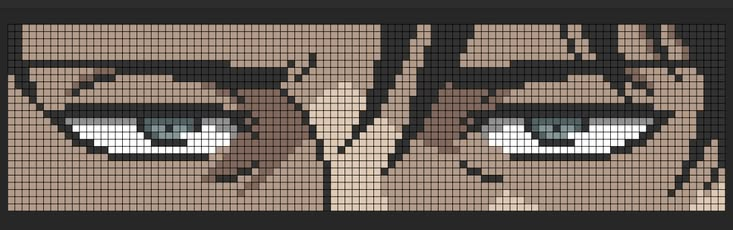

<div align="center">

<picture>
	<source media="(prefers-color-scheme: light)" srcset="https://raw.githubusercontent.com/dapxzhosting/dapxzhosting/main/header-light.svg">
	
</picture>

<picture>
	<source media="(prefers-color-scheme: light)" srcset="https://readme-typing-svg.demolab.com?font=Fira+Code&weight=500&size=22&pause=1000&color=050507&background=FFFFFF00&center=true&vCenter=true&width=560&lines=Hi+there%2C+I'm+Dafa+(Dap)+%F0%9F%91%8B;Full-Stack+Developer;Android+Developer+%7C+Kotlin;React+%7C+Next.js+%7C+Laravel+%7C+Node.js;Open+Source+Enthusiast">
	
</picture>

<br/>

<p>
	<a href="https://dafaalfiansyah.my.id" target="_blank">
		
	</a>
	&nbsp;
	<a href="mailto:dafaalfiansyahdev@outlook.com">
		
	</a>
	&nbsp;
	<a href="https://www.instagram.com/dafa_alf1" target="_blank">
		
	</a>
	&nbsp;
	<a href="https://www.tiktok.com/@dp_spele" target="_blank">
		
	</a>
</p>


<br/><br/>



</div>

---

## 👨‍💻 About Me

```kotlin
object Dafa {
    val name = "Dafa Alfiansyah"
    val alias = "Dap"
    val roles = listOf("Full-Stack Developer", "Android Developer")
    val focus = listOf("Android (Kotlin)", "Web (React / Next.js)", "Backend (Node.js / Laravel)")
    val currentlyBuilding = listOf("FamilyGuard", "Lanfa AI", "DafMoney")
    val funFact = "I like polished UI, smooth animations, and shipping real projects 🚀"
}
```

- 📱 Building native **Android** apps with Kotlin and Firebase
- 🌐 Crafting **modern websites** with React, TypeScript, and Next.js
- ⚙️ Developing **backends and tools** with Node.js, Express, Laravel, and PHP
- 🎨 Obsessed with UI/UX details: scroll animations, light/dark themes, and interfaces that feel truly native

---

## 🔭 Currently Working On

| Project | What I'm doing |
|---------|----------------|
| 🛡️ **FamilyGuard** | Android parental control app: security hardening and open-source preparation |
| 🤖 **Lanfa** | AI assistant for Android and web: bilingual support, chat features, theming |
| 💰 **DafMoney** | Personal finance app: native look and feel, wallets, and new features |

---

## 🛠️ Tech Stack

### 💻 Languages

<p>
	
</p>

### 🎯 Frontend

<p>
	
	<br/>
	
	
</p>

### 📱 Mobile

<p>
	
</p>

### 🔧 Backend & Database

<p>
	
</p>

### ☁️ Deployment & Tools

<p>
	
	<br/>
	
	
	
	
</p>

---

## 🚀 Featured Projects

<table>
	<tr>
		<td width="50%" valign="top">
			<h3>🛡️ FamilyGuard</h3>
			<p>An Android <b>parental control</b> app powered by Firebase Realtime Database, device admin APIs, and hardened security rules.</p>
			
		</td>
		<td width="50%" valign="top">
			<h3>🤖 Lanfa</h3>
			<p>An <b>AI assistant</b> for Android and web with bilingual (ID/EN) support, streaming chat, and custom themes.</p>
			
		</td>
	</tr>
	<tr>
		<td width="50%" valign="top">
			<h3>💰 DafMoney</h3>
			<p>A <b>personal finance</b> app with a native look and feel, multiple wallets, and a full set of transaction features.</p>
			<a href="https://github.com/dapxzhosting/DafMoney">View repository</a>
			<br/>
			
		</td>
		<td width="50%" valign="top">
			<h3>⬇️ Tools Downloader</h3>
			<p>A <b>media downloader</b> for TikTok, Instagram, and CapCut, built with Node.js + Express and deployed on Railway.</p>
			
		</td>
	</tr>
	<tr>
		<td width="50%" valign="top">
			<h3>🍩 Donut Landing Page</h3>
			<p>An interactive landing page with parallax scroll animations and a 3D model, built with Next.js and TypeScript.</p>
			
		</td>
		<td width="50%" valign="top">
			<h3>💬 WhatsApp Bot</h3>
			<p>A multi-purpose <b>WhatsApp bot</b> (Node.js) with prayer-time reminders, a music player, and many utility commands.</p>
			
		</td>
	</tr>
	<tr>
		<td width="50%" valign="top">
			<h3>📚 School Library System</h3>
			<p>A library information system built with <b>Laravel</b> and MySQL, deployed on Railway.</p>
			<a href="https://github.com/dapxzhosting/perpustakaan-">View repository</a>
			<br/>
			
		</td>
		<td width="50%" valign="top">
			<h3>🌐 Portfolio Website</h3>
			<p>My personal portfolio with GSAP animations, a Spotify integration, and an interactive skills section.</p>
			<a href="https://dafaalfiansyah.my.id">dafaalfiansyah.my.id</a>
			<br/>
			
		</td>
	</tr>
</table>

---

## 📊 GitHub Stats

<p align="center">
	
</p>

## 🐍 Contribution Snake

<p align="center">
	<picture>
		<source media="(prefers-color-scheme: dark)" srcset="https://raw.githubusercontent.com/dapxzhosting/dapxzhosting/output/github-snake-dark.svg">
		<source media="(prefers-color-scheme: light)" srcset="https://raw.githubusercontent.com/dapxzhosting/dapxzhosting/output/github-snake.svg">
		
	</picture>
</p>

---

## 🤝 Open to Collaborate

I'm open to freelance work, open-source collaboration, and interesting project ideas, especially around **Android (Kotlin)**, **React / Next.js**, and **Laravel / Node.js**. Feel free to reach out!

<p>
	<a href="mailto:dafaalfiansyahdev@outlook.com?subject=Let%27s%20work%20together">
		
	</a>
</p>

---

## 📬 Connect with Me

<div align="center">

<i>Got an idea, a question, or just want to say hi? My inbox is always open. 👋</i>

<br/><br/>

<table>
	<tr>
		<td align="center" width="50%">
			<a href="https://dafaalfiansyah.my.id" target="_blank">
				
			</a>
		</td>
		<td align="center" width="50%">
			<a href="mailto:dafaalfiansyahdev@outlook.com">
				
			</a>
		</td>
	</tr>
	<tr>
		<td align="center" width="50%">
			<a href="https://www.instagram.com/dafa_alf1" target="_blank">
				
			</a>
		</td>
		<td align="center" width="50%">
			<a href="https://www.tiktok.com/@dp_spele" target="_blank">
				
			</a>
		</td>
	</tr>
	<tr>
		<td align="center" colspan="2">
			<a href="https://github.com/dapxzhosting" target="_blank">
				
			</a>
		</td>
	</tr>
</table>

</div>

---

<div align="center">

<picture>
	<source media="(prefers-color-scheme: light)" srcset="https://raw.githubusercontent.com/dapxzhosting/dapxzhosting/main/footer-light.svg">
	
</picture>

</div>
